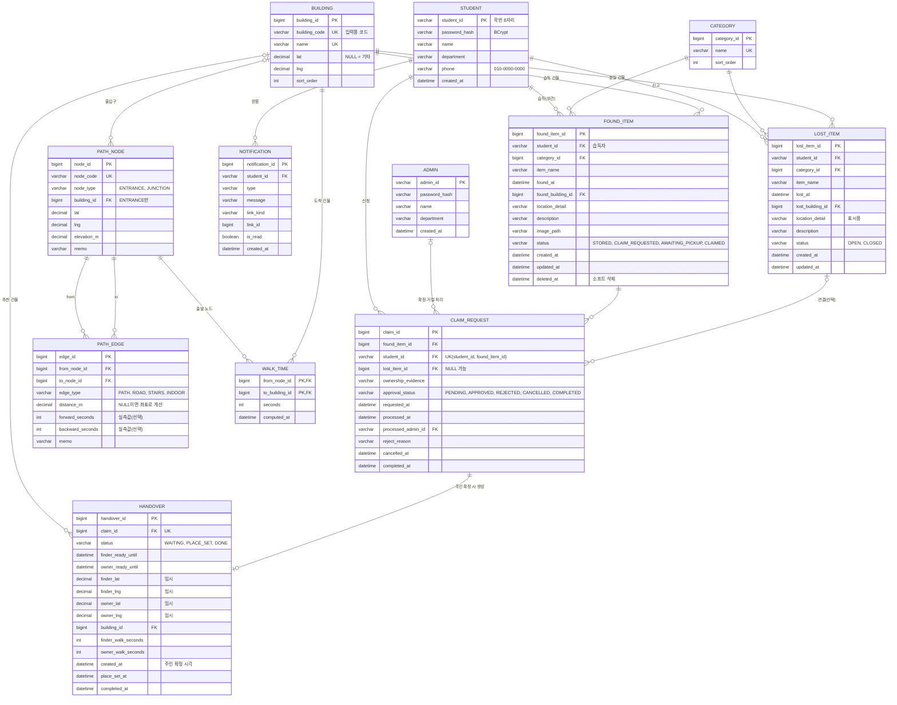
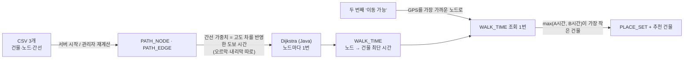

# ERD와 테이블 구조 (v2, 2026-11-23)

기획 확정안(11/17) 4장의 ERD 8개 테이블에 알림(11/22)과 캠퍼스 보행 그래프(11/23, FR-07 C안) 테이블을 더해 **12개 테이블**이다. 실제 DDL은 [`db/schema.sql`](../db/schema.sql)이며, MySQL 8.0.16 이상(CHECK 제약 동작 조건)과 utf8mb4를 기준으로 한다.

| 구분 | 테이블 | 출처 |
| --- | --- | --- |
| 사용자 | STUDENT, ADMIN | PPT |
| 공통 코드 | CATEGORY, BUILDING | PPT, 11/18 |
| 업무 | LOST\_ITEM, FOUND\_ITEM, CLAIM\_REQUEST | PPT (11/18 변경) |
| 전달 (FR-07) | HANDOVER | 11/18 |
| 알림 | NOTIFICATION | 11/22 |
| 보행 그래프 (FR-07 C안) | PATH\_NODE, PATH\_EDGE, WALK\_TIME | 11/23 신규 |

## 다이어그램

## 기획 확정안 ERD에서 바뀐 점

| 대상 | 변경 | 이유 |
| --- | --- | --- |
| NOTIFICATION | 테이블 추가 | 11/22 알림(종) 결정. API 명세 알림 절 |
| PATH\_NODE, PATH\_EDGE, WALK\_TIME | 테이블 추가 | FR-07 추천을 직선거리에서 도보 시간 기반으로 강화 (11/23) |
| BUILDING.building\_code | 컬럼 추가 | 보행 그래프 데이터를 입력할 때 한글 건물명 대신 쓰는 코드 |
| BUILDING.sort\_order, CATEGORY.sort\_order | 컬럼 추가 | 드롭다운 순서를 프론트 목록과 맞춤 |
| FOUND\_ITEM.deleted\_at | 컬럼 추가 | 소프트 삭제 (명세 v1.2). 거절·취소된 신청이 FK로 남아 있어도 삭제 가능 |
| CLAIM\_REQUEST.processed\_at, processed\_admin\_id | 컬럼 추가 | 확정·거절한 시각과 관리자 기록. 기획안에서 FOUND\_ITEM.admin\_id가 빠져 처리자 기록 위치가 없었음 |
| CLAIM\_REQUEST.reject\_reason, cancelled\_at, completed\_at | 컬럼 추가 | 거절 사유(선택), 취소·수령완료 시각 |
| CLAIM\_REQUEST.lost\_item\_id | `ON DELETE SET NULL` | 분실 신고를 지울 때 거절·취소된 신청의 연결만 끊음 (명세 v1.2) |
| HANDOVER.finder\_walk\_seconds, owner\_walk\_seconds | 컬럼 추가 | 장소 확정 시 각자의 예상 도보 시간. 임시 좌표를 지운 뒤에도 패널에 보여주기 위함 |
| HANDOVER.created\_at | 컬럼 명시 | 주인 확정 시각. A4의 날짜 필터 기준 |
| BUILDING의 추천 후보 판정 | 의미 변경 | 기획안: 좌표가 있는 건물 → 이제: ENTRANCE 노드가 1개 이상 있는 건물 (직선거리 대체 모드에서는 좌표가 있는 건물) |

## 관계

- STUDENT 1 : N LOST\_ITEM, FOUND\_ITEM, CLAIM\_REQUEST, NOTIFICATION
- FOUND\_ITEM 1 : N CLAIM\_REQUEST, LOST\_ITEM 1 : N CLAIM\_REQUEST (lost\_item\_id NULL 가능)
- CLAIM\_REQUEST 1 : 0..1 HANDOVER (APPROVED 신청에만 생김)
- BUILDING 1 : N LOST\_ITEM, FOUND\_ITEM, HANDOVER, PATH\_NODE(출입구)
- PATH\_NODE N : M PATH\_NODE (PATH\_EDGE로 연결, 한 행 = 양방향 길 1개)
- WALK\_TIME = PATH\_NODE × BUILDING의 최단 도보 시간 (계산 결과를 저장한 파생 테이블)
- 유사 매칭(LOST\_ITEM N : M FOUND\_ITEM)은 계속 테이블 없이 파생 질의로 처리한다.

## 인덱스

기획안의 인덱스(FOUND\_ITEM의 category\_id, status, found\_at, CLAIM\_REQUEST의 found\_item\_id+approval\_status)를 그대로 두고 아래를 더했다. 적용 전후 `EXPLAIN` 비교는 발표에 쓴다.

| 인덱스 | 쓰는 곳 |
| --- | --- |
| FOUND\_ITEM(found\_building\_id), (student\_id) | 건물 검색, 내 습득 신고 |
| LOST\_ITEM(student\_id, status) | 내 분실 신고, 수령 신청 시 OPEN 신고 선택 |
| HANDOVER(status, created\_at) | A4 전달 현황 필터 |
| NOTIFICATION(student\_id, is\_read, created\_at) | 읽지 않은 수(30초 폴링), 알림 목록 |
| WALK\_TIME PK(from\_node\_id, to\_building\_id) | 장소 추천 쿼리 (두 사람의 노드로 범위 조회) |
| PATH\_EDGE(to\_node\_id) | 그래프 로딩 |

## 보행 그래프와 장소 추천 (FR-07 C안)

기획안 6장의 추천 로직(두 사람 중 더 먼 쪽 거리가 가장 짧은 건물)을 그대로 쓰되, 거리를 **직선거리 대신 실제 길을 따라 걷는 시간**으로 바꾼다.

1. **간선 가중치:** 간선마다 두 방향의 도보 시간을 따로 계산한다. 기본은 Tobler 보행 공식 `속도(km/h) = 6 × e^(-3.5 × |경사 + 0.05|)`이고, 경사 = 고도 차 ÷ 수평 거리. 그래서 같은 길도 오르막이 더 오래 걸린다. 계단(STAIRS)은 `수평거리 ÷ 1.0 m/s + 오른 높이 ÷ 0.2 m/s`(내려갈 때 ÷ 0.35 m/s), 실측 초(forward·backward\_seconds)가 있으면 그 값을 그대로 쓴다. 상수는 설정값으로 두고 실측 후 조정한다.
2. **사전 계산:** 모든 노드에서 Dijkstra를 1번씩 돌려 각 건물의 출입구 중 가장 빠른 곳까지의 시간을 WALK\_TIME에 저장한다. 노드 60개 기준 60번 × (노드 60·간선 80) 수준이라 서버 시작 시 1초 안에 끝난다.
3. **실시간 추천:** 두 사람의 위치를 가장 가까운 노드에 맞추고(맞추는 거리는 평지 속도 1.25 m/s로 시간 환산), WALK\_TIME을 한 번 조회해 건물마다 `A시간 = 맞춤시간A + 표의 시간`, `B시간`을 구한다. `max(A, B)`가 가장 작은 건물, 같으면 `A + B`가 작은 건물, 그래도 같으면 building\_id가 작은 건물.
4. **대체 모드:** WALK\_TIME이 비어 있거나 두 사람 중 한 명이라도 갈 수 있는 건물이 없으면 기획안의 직선거리 SQL(`ST_Distance_Sphere`)로 계산한다. 응답의 `method`로 어느 방식이었는지 알 수 있다.

데이터 수집 방법과 CSV 양식은 [`docs/DATA_GUIDE.md`](DATA_GUIDE.md)를 본다.
